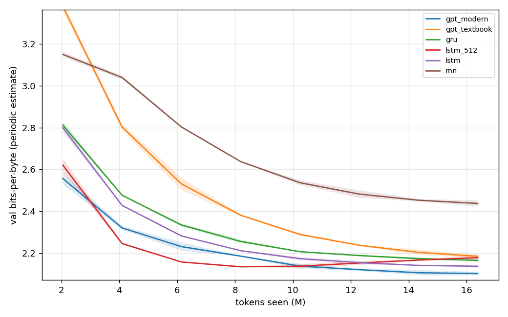
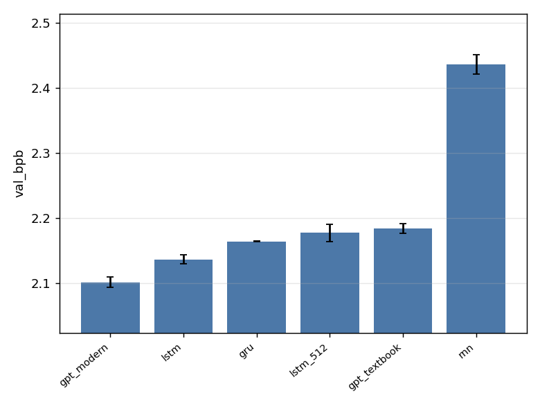
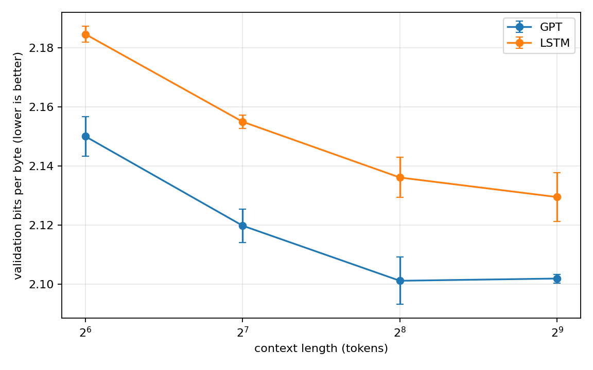
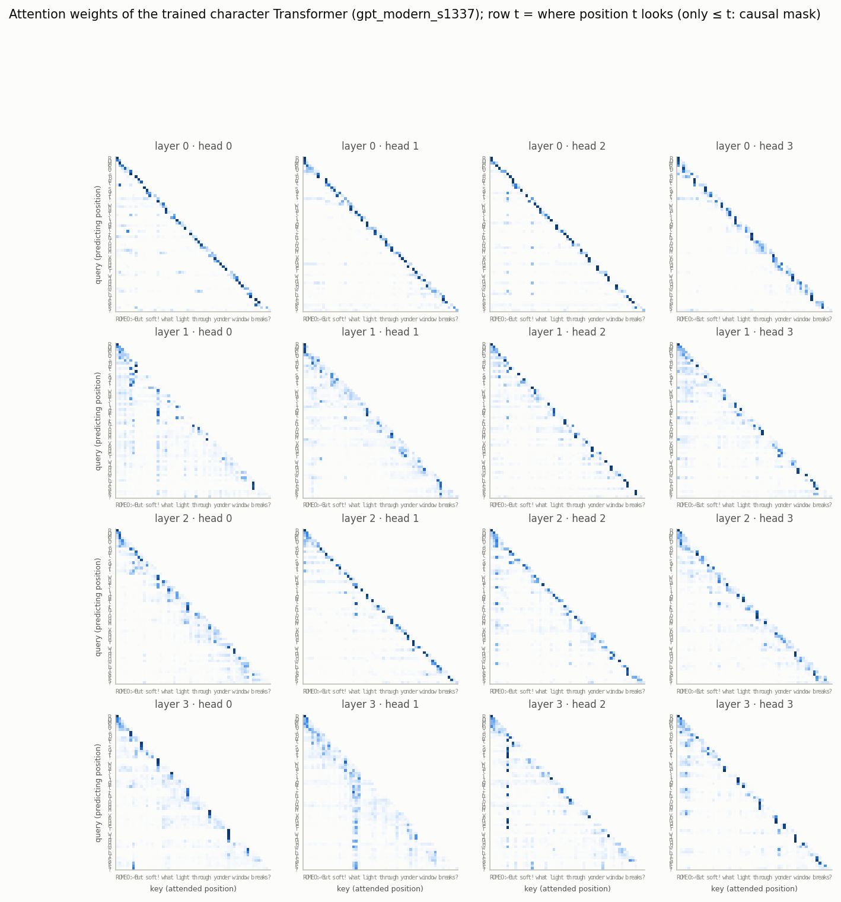
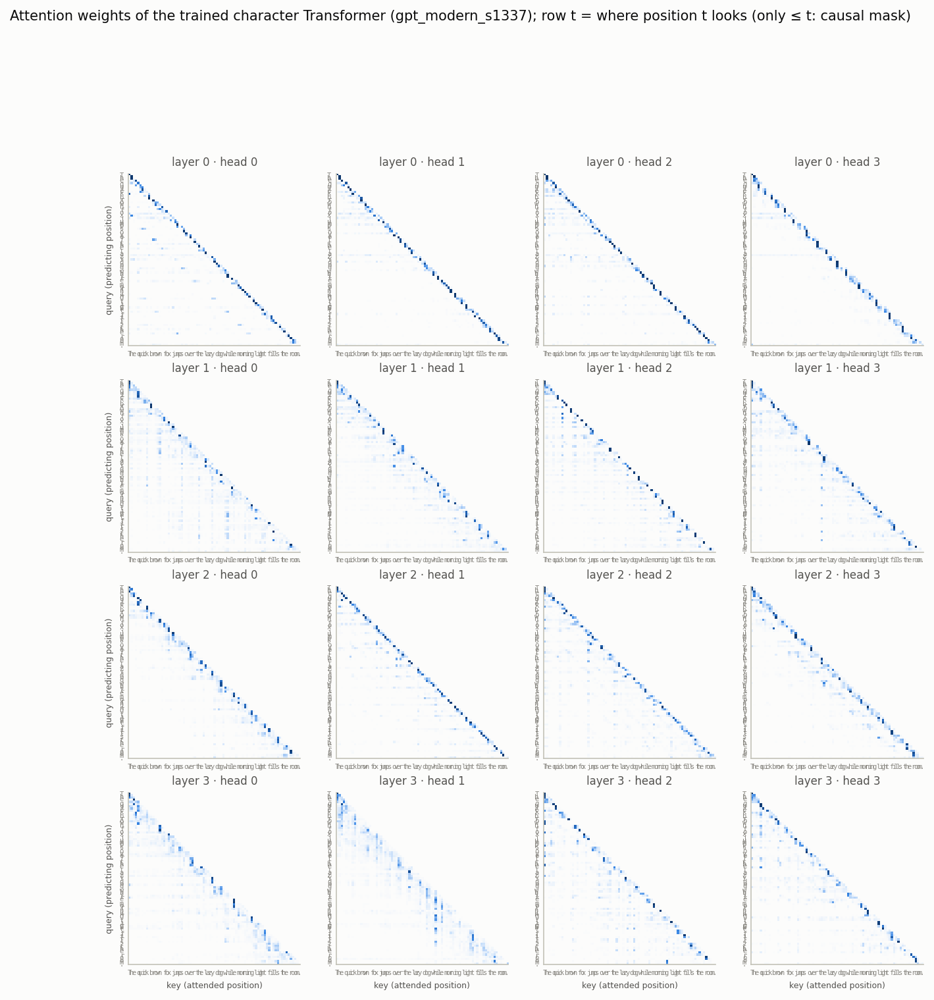
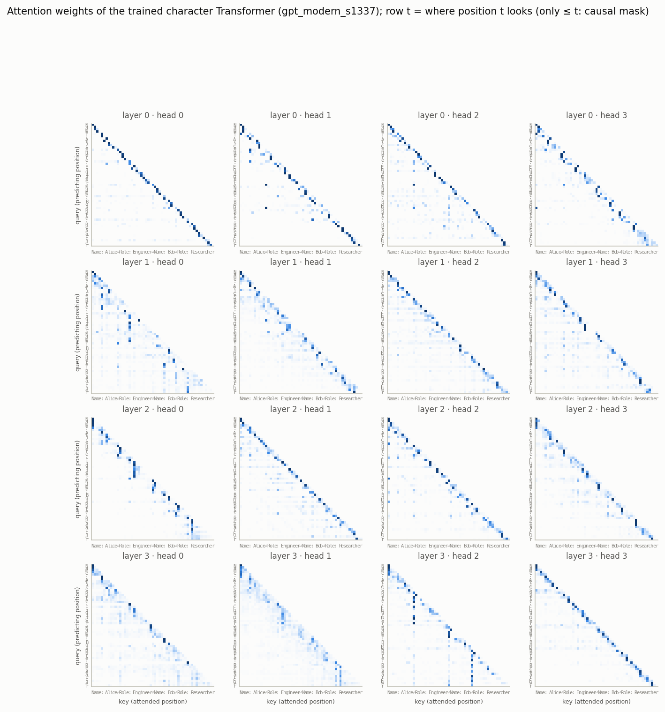
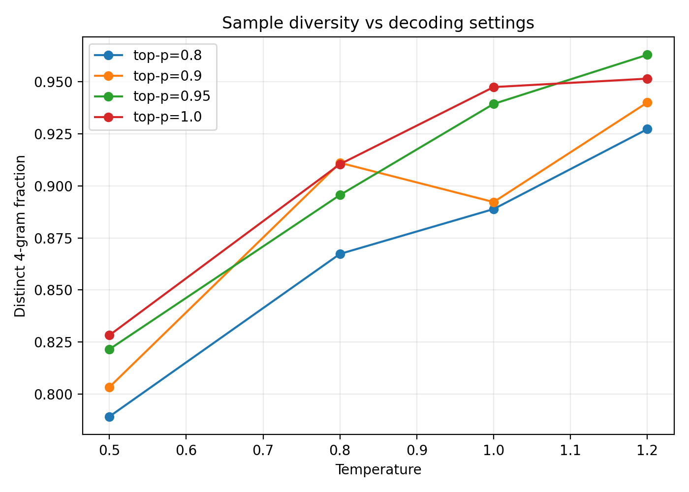

# LM Architecture Bench

A controlled benchmark of small recurrent and Transformer language models on Tiny Shakespeare. The project studies metric interpretation, architecture behavior under a fixed token budget, context-length scaling, attention-head specialization, and decoding diversity.

## Highlights

- A modern Transformer achieved the best architecture-sweep result: **2.1011 bpb**.
- A vanilla RNN lagged substantially at **2.4368 bpb**, while gated recurrent models closed much of the gap.
- Increasing the LSTM hidden size from 256 to 512 **hurt final validation performance** despite increasing parameters from 1.07M to 4.24M.
- The Transformer benefited from context up to about **256 tokens**, then saturated; the LSTM showed a small additional gain at 512 that was within the observed seed-noise scale.
- Attention analysis identified a strong **previous-token head** (L2H1, average relevant-position weight **0.4820**) and a **current-word-start head** (L2H0, **0.4323**).
- At fixed model quality (**2.0955 validation bpb**), distinct 4-gram diversity increased from about **0.789** to **0.963** as sampling became less restrictive.

## Experimental setup

The main benchmark uses the character-level Tiny Shakespeare dataset and the public `nanolm` implementation from `lkk688/DeepDataMiningLearning`.

Architecture runs use:

- 16,384,000 training tokens per run
- sequence length 256 and batch size 32
- two paired seeds: 1337 and 42
- validation bits per byte (bpb) as the primary metric

The context-length study keeps the number of tokens per optimizer step fixed at 8,192 by changing batch size inversely with sequence length:

| Context length | Batch size | Tokens / step |
| ---: | ---: | ---: |
| 64 | 128 | 8,192 |
| 128 | 64 | 8,192 |
| 256 | 32 | 8,192 |
| 512 | 16 | 8,192 |

Final runs were executed on an NVIDIA A100-PCIE-40GB with Python 3.11 and PyTorch 2.6.0+cu124. The upstream source revision is pinned in `references/upstream_commit.txt`.

## 1. Metric verification

For a trained modern Transformer run:

| Quantity | Value |
| --- | ---: |
| Validation loss | 1.4524729652 |
| Validation tokens | 111,360 |
| Validation bytes | 111,360 |
| Recomputed perplexity | 4.2736700956 |
| Logged perplexity | 4.2736700956 |
| Bits / token | 2.0954755440 |
| Recomputed bpb | 2.0954755440 |
| Logged bpb | 2.0954755440 |

The calculations are:

```text
perplexity = exp(val_loss)
bits/token = val_loss / ln(2)
bits/byte  = bits/token * val_tokens / val_bytes
```

The recomputed perplexity and bpb match the logged values exactly to the reported precision.

### Near-untrained tokenizer sanity check

A one-step model should behave close to random guessing, whose expected cross-entropy is approximately `ln(V)` for vocabulary size `V`.

| Tokenizer | Vocab | ln(V) | Observed val loss | Difference |
| --- | ---: | ---: | ---: | ---: |
| Character | 65 | 4.1744 | 4.1707 | -0.0037 |
| Byte | 256 | 5.5452 | 5.4631 | -0.0821 |

The character result is almost exactly at the random baseline. The byte result is also close; the model has already taken one optimization step, so exact equality is not expected.

## 2. Architecture comparison

| Model | Parameters | Mean bpb | Std. dev. |
| --- | ---: | ---: | ---: |
| **Modern Transformer** | 3.16M | **2.1011** | 0.0080 |
| **LSTM-256** | 1.07M | **2.1361** | 0.0068 |
| GRU | 0.81M | 2.1640 | 0.0007 |
| LSTM-512 | 4.24M | 2.1771 | 0.0138 |
| Textbook Transformer | 3.44M | 2.1837 | 0.0073 |
| Vanilla RNN | 0.28M | 2.4368 | 0.0148 |





### Why does the vanilla RNN fall behind?

The vanilla RNN compresses the entire history into a recurrent hidden state without explicit gates. This makes long-range gradient propagation harder and exposes training to vanishing or unstable gradients. The effect is large in this benchmark: its mean bpb is **2.4368**, compared with **2.1640** for the GRU and **2.1361** for the LSTM-256. Gating provides a much better mechanism for retaining and selectively updating information over time.

### Is the larger LSTM better?

No. LSTM-512 finishes at **2.1771 bpb**, worse than the smaller LSTM-256 at **2.1361**, despite using roughly four times as many parameters. The learning curves explain the result: the larger LSTM improves rapidly and reaches a strong validation region around the middle of training, but its validation bpb then rises while the smaller LSTM continues to improve. Under this training recipe and fixed token budget, the larger model generalizes worse and shows evidence of overfitting or insufficient regularization rather than benefiting from its extra capacity.

### Textbook vs. modern Transformer

The modern Transformer uses RMSNorm, rotary positional embeddings, SwiGLU, and bias-free linear layers. It improves mean bpb from **2.1837** to **2.1011** under the same token budget, showing that architectural details matter even at this small scale.

## 3. Context-length scaling

| Context | Modern Transformer bpb | LSTM-256 bpb |
| ---: | ---: | ---: |
| 64 | 2.1500 | 2.1846 |
| 128 | 2.1198 | 2.1550 |
| 256 | **2.1011** | 2.1361 |
| 512 | 2.1019 | **2.1295** |



Both architectures benefit similarly from 64 to 256 tokens. The Transformer then saturates: moving from 256 to 512 changes mean bpb from 2.1011 to 2.1019. The LSTM improves numerically from 2.1361 to 2.1295 over the same step, but the 0.0066-bpb gain is comparable to the measured seed variability and is therefore not strong evidence of a real effect.

The Transformer has lower absolute bpb at every tested context length. In terms of *incremental benefit from additional context*, however, the data does not support a claim that it uses 512-token context more effectively: it reaches its useful-context plateau earlier, near 256 tokens.

## 4. Attention analysis

Attention was visualized on three input types: dialogue, prose, and structured text.







Two recurring head behaviors were quantified:

| Head | Behavior | Mean relevant-position weight |
| --- | --- | ---: |
| Layer 2, Head 1 | Previous token | **0.4820** |
| Layer 2, Head 0 | Current word start | **0.4323** |

For the previous-token head (L2H1), the measured weight is 0.4839 on dialogue, 0.5339 on prose, and 0.4282 on structured text. For the word-start head (L2H0), the corresponding word-start weights are 0.2422, 0.3738, and 0.6810. The behavior therefore persists across qualitatively different inputs rather than appearing in only one example.

## 5. Sample diversity at fixed bpb

The trained modern Transformer checkpoint was held fixed while decoding temperature and top-p were varied. Five sampling seeds were used for each setting, and diversity was measured as the fraction of distinct character 4-grams in a 300-token continuation.

Because the checkpoint never changes, model validation quality stays fixed at **2.0955 bpb**; only the decoding policy changes.



Diversity generally rises with temperature and with a broader sampling nucleus. The lowest tested setting, temperature 0.5 and top-p 0.8, gives mean diversity **0.7892**. The highest observed mean is **0.9630** at temperature 1.2 and top-p 0.95. Small local non-monotonicities are expected from finite sampling and only five generation seeds.

## Main findings

1. **Gating matters.** GRU and LSTM substantially outperform the vanilla RNN under the same token budget.
2. **More parameters are not automatically better.** LSTM-512 overfits relative to LSTM-256 under this training recipe.
3. **Modern Transformer design choices matter.** The modern recipe is the strongest model in the benchmark.
4. **Useful context saturates.** The Transformer gains strongly through 256 tokens but shows no meaningful improvement at 512; the LSTM's additional 512-token gain is small relative to seed noise.
5. **Attention heads specialize.** Clear previous-token and word-start behaviors emerge and can be measured quantitatively.
6. **Decoding controls diversity independently of validation bpb.** Higher temperature and broader top-p sampling generally increase distinct 4-gram diversity without changing the underlying model.

## Reproduction

The external implementation is kept as a sibling dependency rather than copied into this repository:

```text
<workspace>/
├── lm-architecture-bench/
└── _deps/
    └── DeepDataMiningLearning/
```

Bootstrap and smoke-test the environment:

```bash
bash scripts/bootstrap_upstream.sh
python -m pip install -r requirements.txt
bash scripts/smoke.sh
```

Run the experiment stages:

```bash
bash scripts/run_01_metrics.sh
bash scripts/run_02_architecture.sh
bash scripts/run_03_context.sh
bash scripts/run_04_attention.sh
python scripts/run_05_diversity.py
```

Raw checkpoints and sweep directories are intentionally excluded from version control. The repository keeps the experiment definitions, analysis code, and curated figures needed to reproduce and inspect the results.

## Repository layout

```text
lm-architecture-bench/
├── configs/                  # model and sweep definitions
├── scripts/                  # setup, execution, and analysis helpers
├── references/               # upstream revision and attention inputs
├── figures/                  # curated result figures
├── report/                   # write-up material
├── PROJECT_PLAN.md
├── requirements.txt
└── README.md
```

## References

- `nanolm` reference implementation: https://github.com/lkk688/DeepDataMiningLearning/tree/main/DeepDataMiningLearning/llm/nanolm
- Project repository: https://github.com/Parth-Panchal-284/lm-architecture-bench
